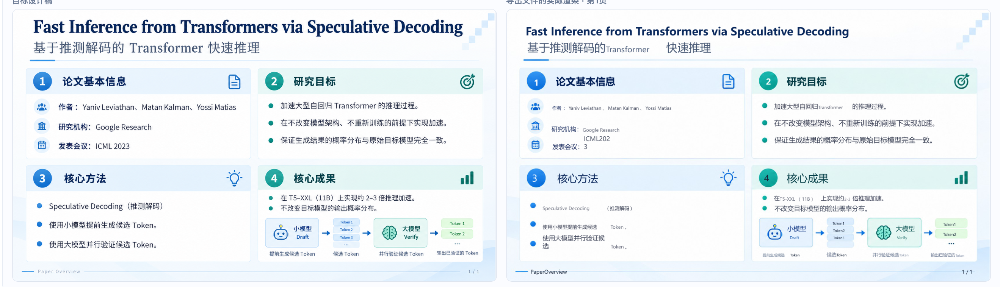
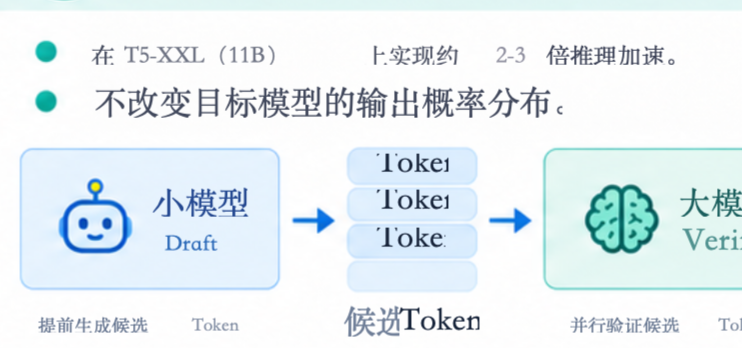
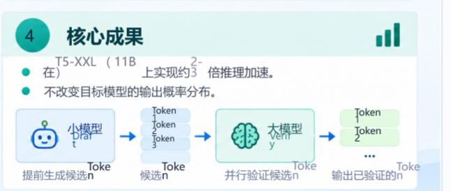
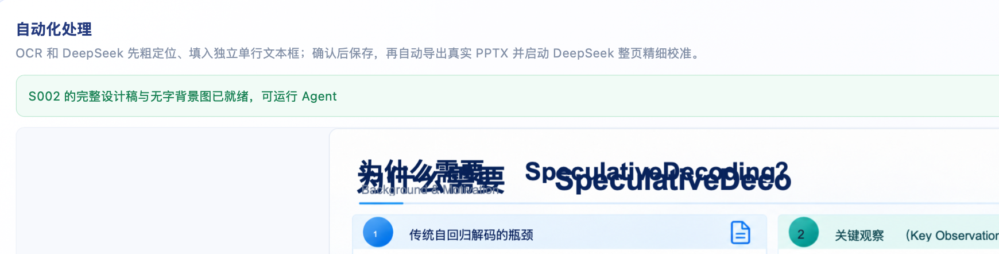
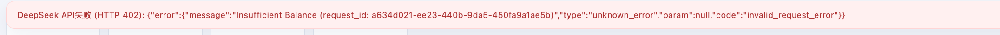
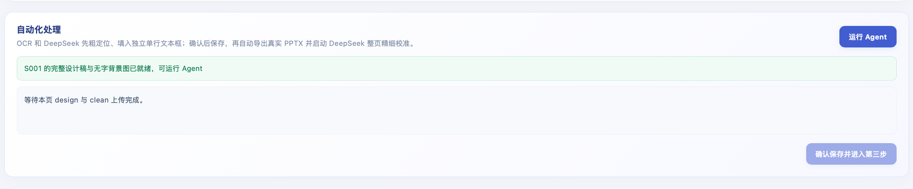

# Visual PPT Studio 当前问题清单

这份清单汇总用户在真实 PPTX/Office 使用中报告的问题，并附上原始截图作为复现证据。截图来自同一套 Transformer 示例页面。它们用于说明可见现象，不等同于已经完成根因验证。

## 总体判断

当前主要阻塞点在“识别结果如何变成可编辑文本框”以及“导出后如何验证”两处。页面虽然能生成 PPTX，且系统能给出数值分数，但部分页面仍有明显的中英文间距、字号、裁切和重叠问题。用户实际使用 Microsoft Office；项目自动生成的预览目前来自 LibreOffice，因此不能把 LibreOffice 渲染或当前分数当成 Office 验收结果。

DeepSeek 曾返回 HTTP 402 `Insufficient Balance`。在这种情况下本轮模型校准没有获得可执行建议；这是自动修正被阻断的直接原因之一，但它本身不能解释 OCR 重建时已经出现的坐标和字体问题。

## 问题列表

### 1. 中英文混排的间距不自然，文字没有按自然行内间距衔接

**可见现象：** 中文和英文之间出现远大于正常输入的空白，例如“加速大型自回归 Transformer 的推理过程”被排成中英文互相隔开；“Speculative Decoding（推测解码）”以及 `Token` 也会与相邻中文脱节。用户要求不同文字类别可以分成独立文本框，但同一行仍要紧密、自然地衔接，一个文本框只放一行。

**代码层的已知线索：** OCR 提供的是图片中的检测矩形，不是选定字体在 PPT 中的实际字宽。当前重建流程会将混合文字拆成不同文本框，并以 OCR 坐标保存位置。相邻框没有普遍根据最终字体的实际字宽串接计算。因而即使文本内容识别正确，位置也可能留出大空隙、重叠或错位。需继续核查字号、文本框内边距、字体替代及 reflow/group 逻辑，确定每种复现的具体贡献。

### 2. 字号偏小、同页字号不一致

**可见现象：** 导出页中的正文、英文片段或小标签比设计稿明显小；同一行里的中文与英文看起来字号不同。存在为了适配 OCR 框而缩小文字的风险。

**待核查：** 区分设计稿原始字高、OCR 框高、保存的字号、PPTX 文字框尺寸与 Office 最终字号。不能只用整个文字框是否溢出来判断字号匹配。

证据见上方设计稿与导出稿对比图。

### 3. 英文及图示文字发生裁切、上下不全或拆碎

**可见现象：** `Token` 在候选 Token 图示里被裁掉上沿/下沿，部分字符或词被错误拆开，标签文字挤在框外；中文和英文的基线也不一致。

**待核查：** 文本框高度、内边距、垂直锚定、行高、自动换行、字号和 font metrics 是否符合 Office 的实际行为。流程要求单个框只容纳一行，因此需要显式关闭自动换行或在溢出时重新计算框宽，不能把一行挤成多行。

### 4. 重复文字叠印，出现两份标题或正文

**可见现象：** 有页面出现标题重影/两份文字重叠，导出视觉上像同一标题重复绘制。

**可能原因，尚需数据验证：** clean 底图仍残留原始文字，同时 PPTX 又叠加可编辑文字；也可能是 OCR/重建重复创建了原生文本对象。需要分别检查 clean 图片像素、项目 `elements` 列表和最终 PPTX 的 shape 列表，不能只通过移动其中一份来掩盖。

### 5. 小字、页码、页脚和图示微小标签识别不完整

**可见现象：** 用户发现页码或底部小字没有识别；图示中的小标签、页脚文字也容易漏掉。曾出现导出完整性校验报告 S001 原生文字数与预期文字数不一致，S002 则通过的情况。

**待核查：** OCR 是否有足够分辨率/多尺度处理；设计稿文字清单是否包含页码与微小标签；完整性比较是否会把标点、英文大小写、空格或重复内容误判为缺失。漏字要在导出前被明确列出，不能仅看总分。

### 6. OCR 识别到文字，但文字颜色与背景相近，导致看不清

**可见现象：** 文本框区域已被识别/框出，但填入的字与背景颜色接近，视觉上像是没有文字。

**待核查：** 是否沿用到背景采样色或错误读取原稿颜色；应在文本候选阶段用 OCR 原稿局部颜色估算文字前景色，并进行局部对比度检查。自动纠色必须针对文字前景和背景分离，不能把整框背景色当作文字颜色。

### 7. 视觉分数没有反映明显的排版缺陷

**可见现象：** 页面肉眼仍有明显空隙、字号和裁切问题时，数值评分可能仍较高或多轮没有变化；候选可能被回滚，也可能显示模型处理但页面肉眼无变化。

**待核查：** 当前自动评分分别如何量化文字内容、几何位置、字号、颜色、溢出和背景相似度；是否真的单独检测了中英文行内空隙、基线和字形裁切。评分达到某个阈值不能替代人工和 Office 渲染验收。每轮应显示具体对象的旧值、新值、是否写入、渲染前后差异和保留/回滚理由。

### 8. DeepSeek 自动校准受 API 余额错误阻断

**可见现象：** 页面显示 DeepSeek API HTTP 402 `Insufficient Balance`。发生此错误时不能得到有效校准结果；用户之前也遇到过长时间运行后 PPT 和分数均未变。

**处理要求：** 把 API 失败状态与“完成优化”分开显示，保存错误轮次，不要把超时/余额不足记成模型已检查或候选已应用。余额恢复后仍需通过导出渲染证明修复有效。

### 9. Office 中的最终 PPTX 与网页/自动预览不一致

**可见现象：** 用户使用 Microsoft Office 打开导出 PPTX，实际版面和网页预览或之前宣称的检查结果不一致。

**已知验证边界：** `studio/server.py` 当前导出预览路径使用 LibreOffice 转 PDF/PNG；这不是 Microsoft Office 的渲染。Office 可能受字体缺失/替代、行高、文字框内边距、自动换行与 PPTX 渲染差异影响。此前没有充分证据证明最终文件已在 Microsoft Office 中逐页验证。

**处理要求：** 将实际 Office 渲染设为用户最终验收。若开发环境不能自动调用 Office，应明确说明只完成 LibreOffice 检查，并让用户提供 Office 导出的 PDF/截图供回归比对。

### 10. 多页第二步的保存/进入第三步流程曾造成困惑

**可见现象：** 用户希望第二步逐页粗定位、填入文字并分别保存；不能因为单页 Agent 完成就让其它页无处继续，也不能在还有页面未完成时误以为整套项目已进入第三步。历史界面一处同时显示“本页可运行 Agent”和“等待本页 design 与 clean 上传”，确认按钮又处于不可用状态。

**当前状态说明：** 项目近期代码已调整为按页保存与整套流程状态分离。仍应对 2 页以上项目做浏览器回归：逐页上传、运行、保存、切页、刷新，再确认所有页面状态和第三步入口均正确；当前证据截图来自调整前的界面状态，不能单独证明现有代码仍有同一故障。

## 必须保留的用户排版规则

- 每个文本框只放一行，不在同一个文本框里自动换行；需要换行就建立另一个文本框。
- 不同类别文字（例如中文、英文/数字、公式）分别使用不同文本框。
- 虽然类别分框，同一视觉行仍必须自然紧贴，不额外加入空格，行首、字号、基线应一致。
- 一轮整页优化可以同时调整所有相关对象，不能限制为每轮只能修改一个元素。
- 每一轮 DeepSeek 都要看到上一轮反馈和上一轮实际参数；必须记录本轮具体字段变更及重新渲染结果。
- 微小文字、页码、页脚和图示标签也属于需要识别/核验的内容。
- 以最终导出的 PPTX 在 Microsoft Office 中的实际效果验收，不以模型自评或 LibreOffice 单独验收。

## 请接手的 ChatGPT 优先排查顺序

1. 从 S001/S002 的原图、design、clean、`project.json` 文本对象和最终 PPTX 建立逐对象追踪表：原始文字、OCR 框、拆分片段、字体/字号/边距、PPTX 坐标、Office 实际结果。
2. 首先修复“混合语言单行分框但自然衔接”的排版算法：保留同一行关联 ID；按实际字体测量每段字宽并连续排框；处理 Office 字体替代、框内边距和小数坐标；同时保证单行、不裁切。
3. 建立 PPTX 中的文字完整性、重复对象、溢出/裁切、页码/微文识别和前景/背景对比度检查，并把失败对象直接列出来。
4. 区分 API 失败、候选未写入、候选写入但评分回滚、评分没有检测到缺陷等状态。保留每轮精确参数和可见差异。
5. 对多页保存流程做回归，并用 Microsoft Office 实际打开最终文件复核。完成前不要宣称“英文已检查通过”或“问题已修复”。

## 关键代码入口

- `web/app.js`：Agent 重建、OCR 文字框拆分、文字框 reflow、逐页保存及全页自动校准。
- `studio/reconstruction.py`：RapidOCR/Tesseract 识别、文字区域和几何评分。
- `studio/ai.py`：DeepSeek 分析、视觉诊断和参数候选。
- `studio/pptx_native.py`：PowerPoint 原生对象生成和字体/布局处理。
- `studio/server.py`：FastAPI API、PPTX 导出及 LibreOffice 预览渲染。
- `workspace/`：运行时用户项目数据；已被 Git 忽略，不包含在公开仓库中。
