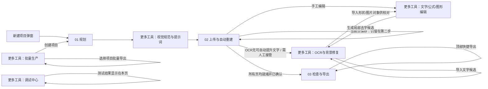

# Visual PPT Studio 前端逐页布局与交互规格

**用途：** 本文是 Google Stitch 与前端实现的完整需求底稿。逐页说明界面如何分区、显示哪些按钮、按钮执行什么操作以及操作后去哪里。改版时保留产品功能和数据流；视觉方案可以重做。

**项目位置：** `web/index.html`、`web/style.css`、`web/app.js`。当前前端是单页应用：主导航切换隐藏/显示页面区块，不通过浏览器 URL 路由。

---

## 0. 全局信息架构与页面跳转

### 页面清单

主流程有 3 页：

1. **规划**：逐页定义标题、正文、视觉意图和备注。
2. **上传与自动重建**：按页上传 design/clean，运行 Agent、检查文字框并逐页保存。
3. **检查与导出**：运行规则检查，导出整套 PPTX，查看逐页渲染并进行整页校准。

“更多工具”里有 5 页：

4. **视觉规范与提示词**：维护全套 Design System，生成/复制每页设计稿和 clean 提示词。
5. **文字 / 公式 / 图形编辑**：逐页手动编辑原生 PPT 对象。
6. **OCR 与背景修复**：识别文字、校对坐标、选择性提升为原生对象、生成去字候选。
7. **批量生产**：导入 CSV 创建多个项目，选择项目并批量导出。
8. **调试中心**：测试 DeepSeek 连接、查看本地运行环境和各模块结构数据。

### 主流程与侧向跳转

### 全局框架

- **左侧固定项目栏**：品牌名和副标题；项目列表（点击切换项目）；刷新项目列表按钮；“新建 PPT 项目”主按钮；底部简短说明。
- **主区域顶部**：当前项目名称、主题/受众/页数摘要、规划锁定状态；右侧全局“导出 PPTX”按钮。
- **主导航**：规划、上传与自动重建、检查与导出三个主入口；“更多工具”下拉包含另外五页。点页面入口后更新当前选中态并显示对应页面。
- **全局消息**：操作成功、警告、错误以页面顶部通知显示；长结果留在当前页面的结果面板里。
- **响应式**：桌面端保持左导航与主工作区；窄屏时导航转为可折叠/横向选择，表格与双图对照改为纵向，不隐藏关键操作。

### 全局按钮与跳转

| 按钮 | 位置 | 动作与去向 |
|---|---|---|
| 刷新 `↻` | 左侧项目栏标题旁 | 重新读取项目列表，留在当前页。 |
| `＋ 新建PPT项目` | 左侧栏底部 | 打开“创建新的演示文稿”弹窗。创建成功后选中新项目并进入“规划”。 |
| 项目名称卡片 | 左侧项目列表 | 切换当前项目，默认选择该项目第一页；留在当前主导航页。 |
| `导出 PPTX` | 顶部全局操作 | 跳转到“检查与导出”，执行一次普通 editable PPTX 导出与渲染；不自动启动 DeepSeek 校准。 |
| 主流程三项 / 更多工具菜单项 | 顶部导航 | 切换到相应页面；不丢失已保存项目数据。 |

---

## 1. 新建项目弹窗

### 布局

居中模态弹窗，表单单列，底部右对齐操作按钮。遮罩下保留当前工作区上下文。

### 字段

- 项目名称（必填）
- 主题 / 一句话简介（必填）
- 预建页数（1–60，默认 8）
- 设计风格：现代编辑、未来科技、温暖商业、克制极简
- 受众（默认“通用受众”）
- 提示文字：这里只创建空白页面框架；项目名和主题不会自动写入第一页正文。

### 按钮与去向

| 按钮 | 动作与去向 |
|---|---|
| `取消` | 关闭弹窗，不创建项目，留在原页。 |
| `创建项目` | 校验必填项，创建项目，选中该项目，关闭弹窗并进入“规划”。 |

---

## 2. 01 规划

### 页面目标

先把整套演示文稿拆成固定页码的内容计划。用户在这里确认每页内容，再锁定页码；图片提示词在“视觉规范与提示词”页处理。

### 布局

1. **页头**：标题“逐页内容规划”和简短说明；右上放 `DeepSeek 生成建议`、`锁定规划`。
2. **统计条**：页面数、完整设计稿数、无字背景数、规划状态。
3. **双栏主体**：左侧逐页列表；右侧当前页编辑表单。
4. **AI 建议区**：点击 AI 建议后出现在正文下方，不遮挡表单；应用前可以检查建议。

### 左侧：每页规划表

- 每行显示固定页码（S001…）、标题/待规划状态、视觉意图摘要、是否已有 design/clean。
- 点击一行切换当前页并刷新右侧编辑表单。
- 页码在项目创建后固定，不允许拖拽排序导致编号改变。

### 右侧：页面内容编辑

- 页面标题
- 正文 / 核心内容
- 视觉意图（用于提示词）
- 讲者备注
- `保存该页内容`

### 按钮与去向

| 按钮 | 动作与去向 |
|---|---|
| `DeepSeek 生成建议` | 生成整套逐页内容建议，在本页下方显示；不自动覆盖当前规划。 |
| 建议区 `应用全部建议到规划` | 将建议写入对应页面规划，刷新当前项目并留在本页；用户可继续检查和修改。 |
| `保存该页内容` | 只保存当前页标题、正文、视觉意图和备注；留在“规划”。 |
| `锁定规划` | 锁定页码/规划并刷新状态；留在“规划”。当前实现锁定后按钮变为“已锁定”且不可点。 |
| 页面列表中的 S 编号/标题 | 切换当前编辑页；留在“规划”。 |

### 后续去向

锁定后，用户可从主导航进入“视觉规范与提示词”生成图像 Prompt；然后进入“上传与自动重建”。规划页不应假装已经生成了设计图片。

---

## 3. 更多工具：视觉规范与提示词

### 页面目标

统一全套视觉规范，逐页准备两阶段图像提示词；把 Prompt 复制到 ChatGPT Image 手动生图并保存后，再到上传页。

### 布局

1. **页头**：标题和说明；右侧 `AI 设计风格建议`。
2. **双卡片区**：左侧 Design System 表单；右侧编号生图操作步骤及 ZIP 下载。
3. **逐页 Prompt 卡片**：顶部显示当前页码和 3 个动作；下方左右并排完整设计稿 Prompt / 无字背景 Prompt；底部为可选透明素材 Prompt。
4. **AI 建议区**：风格建议显示在页底；用户应用后才更新 palette。

### Design System 字段

- 背景 BG、文字 INK、强调 ACCENT、辅助 MUTED
- 字体
- 色板预览
- `保存 Design System`

### 人工生图步骤

显示：先规划锁页 → 复制完整设计稿 Prompt → 生成并保存 `S001_design.png` → 基于 design 编辑得到无字 `S001_clean.png` → 按页上传 → 编辑与质检。

### 按钮与去向

| 按钮 | 动作与去向 |
|---|---|
| `AI 设计风格建议` | 生成调色板/字体建议，在本页显示，不自动应用。 |
| 建议区 `应用视觉调色板` | 保存建议的颜色和字体，刷新本页。 |
| `保存 Design System` | 保存四种颜色和字体，刷新页面并留在本页。 |
| `下载整套编号提示词 ZIP` | 生成并下载所有页面的 Prompt ZIP，留在本页。 |
| `DeepSeek 生成配对 Prompt` | 生成当前页的 design/clean Prompt 并填入下方文本框；不自动跳转。 |
| `复制完整设计稿提示词` | 复制左侧当前页 Prompt，用户转到 ChatGPT Image 手工生成图片。 |
| `复制无字图编辑提示词` | 复制右侧当前页 clean Prompt，用户在 ChatGPT Image 中编辑当前 design。 |
| `复制修订提示词`（图片质检后出现） | 复制 DeepSeek 基于配对审核修订的 clean Prompt。 |
| “上传与自动重建”主导航 | 转到逐页上传页。 |

### Prompt 区域

- 左框：阶段一，完整视觉设计稿（含文字）。
- 右框：阶段二，从 design 编辑成无文字背景。
- 下框：可选独立透明素材 Prompt。
- 文本框只读；复制按钮负责传递内容，不直接调用图像生成 API。

---

## 4. 02 上传与自动重建

### 页面目标

逐页上传 design/clean；每页运行 Agent、检查当前页候选并单独保存。全部页面均就绪且保存后，才从本页统一进入第三步。

### 布局

1. **页头**：说明逐页工作方式、自动校准规则；显示当前项目需要人工介入与否。
2. **统计条**：页数、design 数、clean 数、透明素材数。
3. **主要上传卡片**：页面选择、上传角色选择、拖放区域、待上传预览和保存资产详情。
4. **Agent 卡片**：左侧/主体显示当前页准备状态和结果预览；右上 `运行当前页 Agent`；候选完成后显示本页确认按钮；底部显示整套多页进度及唯一的全套第三步入口。
5. **折叠高级区**：批量上传、图片资产总览、配对复核和 clean Prompt 修订。

### 主要上传卡片的字段与动作

- 页面下拉框：选择 S001…S0XX，切换时当前页图片/Agent 状态同步更新。
- 上传类型下拉框：完整设计稿（含文字）、无字背景图、透明素材一/二。
- 图片选择/拖放：PNG/JPG/WEBP；先显示待上传预览。
- 待上传预览中动态出现：`换一张`、`清除`。
- 上传后显示当前保存文件、缩略图、原文件名、系统文件名。

| 按钮 | 动作与去向 |
|---|---|
| `上传图片` | 保存当前页/当前角色图片；留在本页。上传 design 和 clean 后自动启动配对审核。 |
| `换一张` | 重新选择本地图片；尚未提交上传。 |
| `清除` | 清空当前待上传选择；不删除已保存资产。 |
| `移除这张图` | 删除当前页、当前角色已保存图片；留在本页。 |
| `撤回移除` | 恢复刚刚移除的图片；留在本页。 |

### Agent 卡片

- 显示当前页是否缺 design/clean、配对是否有效、是否已保存。
- Agent 按钮只有当前页 design 与配对 clean 均有效时启用。
- 运行结果区显示配对检查、OCR 区域数、拆分框数、自动提升/待复核数量、模型状态。
- 显示当前页 clean 背景和待提升文字的叠加预览；预览需要清楚看出每一行文字颜色、大小与落点。
- 候选确认后显示“本页已保存”和第二步总进度，不自动替用户跳过其他页。
- 总进度列表逐页显示：缺 design、缺 clean、配对无效、待运行、候选待确认、已保存；点击条目切换到对应页。

| 按钮 | 动作与去向 |
|---|---|
| `运行当前页 Agent` | 对当前页做配对检查、OCR 和结构分析；生成候选预览；留在本页。低置信度无可提升文本时，可转到 OCR 与背景修复页人工处理。 |
| `确认保存本页` | 只保存当前页文字对象/已确认的 clean 修复，并保持在第二步；其他页继续待处理。 |
| `全部页面已完成 · 进入第三步` | 只有所有页 design/clean 配对有效且都确认保存后启用；导出整套 PPTX，进入“检查与导出”并按开关执行 DeepSeek 校准。失败后留在 QA，可重试。 |
| 总进度中的页面条目 | 切换到该页；若当前候选尚未确认则阻止切页并提示先保存。 |

**重要文案一致性要求：** 当前代码在候选生成后曾把单页确认按钮动态改成“确认保存并进入第三步”，但其实际动作是只保存本页、仍留在第二步；真正进入第三步的是下面的整套按钮。改版时单页按钮固定叫 **“确认保存本页”**，全套按钮固定叫 **“全部页面完成后进入第三步”**，不要把两种动作混为一谈。

### 折叠区：批量上传与图片质检

- **批量上传卡**：文件名需要含页码和角色，例如 `S001_design.png`、`S001_clean.png`；多文件拖放/选择。
- `验证并批量上传`：验证命名、页码和角色，上传并显示每个文件的成功/失败；留在本页。
- **当前项目图片卡**：逐页缩略图表（design、clean、assets）。
- `重新检查图片配对`：手动重新请求当前页 design/clean 配对检查，结果显示在下方。
- `优化无字图提示词`：基于当前配对检查修订 clean Prompt；没有有效报告时禁用。修订结果显示在卡内。
- `复制修订提示词`：复制修订版 clean Prompt，仍留在本页。

---

## 5. 03 检查与导出

### 页面目标

执行本地规则审核、生成最终 PPTX 并检查每一页的真实渲染。普通导出与 DeepSeek 自动校准是两个不同动作。

### 布局

1. **页头**：标题；右上 `规则审计`、`导出并渲染 PPTX`。
2. **双栏**：左边几何/文件完整性错误和警告；右边 PPTX 输出报告、自动优化开关、逐页检查/优化操作、逐轮日志。
3. **下方全宽区**：每页目标设计稿与导出渲染预览左右并排；项目有未重新导出的修改时显示预览过期状态。

### 按钮、开关与去向

| 控件 | 动作与去向 |
|---|---|
| `规则审计` | 运行本地几何、资源、完整性检查；结果留在左栏。 |
| `导出并渲染 PPTX` | 导出 editable PPTX 并生成预览；更新报告和每页预览；不主动启动 DeepSeek。 |
| 自动优化“导出后视觉检查”开关 | 控制整页自动优化时是否做导出后的视觉实测。 |
| “DeepSeek 自动校准并应用候选”开关 | 控制整页自动优化时是否自动写入模型候选；普通导出不受影响。 |
| `检查本页` | 对当前页调用 DeepSeek 视觉 QA，诊断显示在本页结果区；不自动应用参数。 |
| `启动整页自动优化` | 对全套逐页实测并让 DeepSeek 联合调整当前页多个关联文字对象；逐轮导出/评分，保留提升版或回滚。运行中按钮变为停止操作。 |
| 运行中的 `停止自动优化` | 请求停止后续轮次并恢复各页最佳版本；留在 QA。 |
| 每页 `暂停此页优化` / `恢复此页优化` | 仅暂停/恢复该页后续轮次；其他页继续。 |
| 每条结果 `查看建议` | 将目标页和建议载入 QA 详情，保留在 QA；不跳到编辑器，不代表候选已写入。 |
| 过期报告的 `重新导出`（有改动时出现） | 跳到 QA 并重新生成 editable PPTX 和预览。 |
| 下载 PPTX/PDF（报告内动态链接） | 下载本次报告对应的产物。 |

### 结果与状态必须分清

- 规则通过 / 有硬错误 / 有警告
- PPTX 正在导出 / 导出成功 / 导出失败
- 预览渲染器名称和预览是否过期
- DeepSeek 请求成功 / 余额不足或请求失败 / 返回空候选
- 候选已应用 / 候选未改变参数 / 写入失败 / 实测提升并保留 / 实测未提升并回滚
- 每页分数是系统实测；模型自评单独标识，不作为验收分

---

## 6. 更多工具：文字 / 公式 / 图形编辑

### 页面目标

逐页查看实时编辑草稿、添加和调整 PowerPoint 原生对象，并保存到项目。

### 布局

- **页头**：标题/说明；右上 `AI识别设计稿布局`、`保存布局`。
- **左侧大工作区**：16:9 画布；上方三态模式按钮；下方对位透明度滑杆和局部去字入口。
- **右侧属性面板**：新增对象按钮组、对象选择、文字/公式内容、坐标尺寸、样式、高级排版和素材选择。
- AI 布局识别候选显示在画布下方；需显式应用后才进入当前编辑预览。

### 画布模式

- `可编辑预览`：显示当前原生对象草稿，可拖动选择。
- `原设计稿`：查看 design。
- `标注去字选区`：在画布拖框添加 mask。
- 对位透明度滑杆：在可编辑预览上叠加 design 作位置比对。
- 双击文本对象可以在弹窗输入文字。

### 属性面板字段

- 新增：文本、公式、矩形、圆形、线条、素材。
- 选中对象下拉；对象文字/LaTeX 源码。
- x/y/w/h 归一化坐标；字号；前景色；字间距；行距。
- 高级：四边内边距、段前/段后、垂直对齐。
- 字体、图像素材、加粗、斜体。

### 按钮与去向

| 按钮 | 动作与去向 |
|---|---|
| `AI识别设计稿布局` | 生成对象坐标建议并在本页显示；不自动应用。 |
| 建议区 `应用标题和正文框坐标` | 将识别的标题/正文框加入当前编辑预览；留在本页，仍需 `保存布局`。 |
| `保存布局` | 保存当前页所有原生元素；留在本页。 |
| `+ 文本/公式/矩形/圆形/线条/素材` | 在当前页新增相应对象并选中；留在本页。 |
| `应用属性` | 将右侧输入应用到选中对象预览；留在本页，需另点保存。 |
| `移除元素` | 从当前编辑草稿移除选中对象；留在本页，需另点保存。 |
| `生成局部去字候选` | 将画布切到框选状态后绘制一个或多个选区；生成候选后自动跳转到“OCR 与背景修复”显示 mask/候选。 |
| 画布拖动/双击 | 拖动改坐标；双击文本编辑内容；仅更改草稿，最终点保存。 |

### 字段变更与导出预览

编辑器是浏览器草稿预览；用户需在 QA 看最终 PPTX 的渲染结果。设计改版应明确标出“尚未保存”和“预览不是最新导出”状态。

---

## 7. 更多工具：OCR 与背景修复

### 页面目标

给复杂信息图做选择性重建。人工校对 OCR 区域，只把选中的文字去字并提升成原生对象；图像修复始终先生成候选，再单独确认。

### 页面布局

这是纵向工作流页面，必须明显区分并编号：

1. **建立基线**：说明复杂信息图可保留整图作为底图，只提升选中的文字/对象；提供重置本页基线和 OCR 覆盖统计。
2. **图片与文字定位**：左侧设计图/识别框/可拖动裁剪框；右侧素材裁剪坐标、透明化选项和提取按钮；顶部有 OCR 引擎选择与识别操作。
3. **选择性提升与人工校对**：搜索、分页、逐区域表格和提升复选框；顶部有批量操作。
4. **精细 Mask 与背景修复**：Mask 算法、修复算法、padding/阈值参数；生成候选、确认候选、渲染差异分析；展示局部放大、Mask、候选和差异图。

### 第一步：基线

- `以原图建立基线（重置本页元素）`：创建保留原始设计图的基线并重置本页原生对象。属于破坏性编辑，应在按钮旁说明影响并要求二次确认/支持撤销。
- 页面显示当前页码和覆盖率：已确认原生文字区域 / OCR 区域 / 估计仍为位图的文字区域。

### 第二步：图片与文字定位

- OCR 引擎下拉：自动、RapidOCR、Tesseract。
- `本地 OCR 识别文字`：在本机运行 OCR，将区域载入下方校对表，默认不自动勾选提升。
- `DeepSeek 识别页面结构`：分析文字、面板、线/箭头、插画；结构草案出现在图片区附近，逐条复选。
- 结构建议里的 `导入勾选对象供校对`：文字候选进入文字区域表；形状/图片候选进入编辑器并**跳转到文字/公式/图形编辑页**。所有候选均需校对/保存。
- 设计图上拖拽选素材裁剪框；右侧编辑 X/Y/W/H；可选“尝试对纯色背景做透明化”。
- `提取为 S00X_asset_XX.png`：提取可见像素为项目独立素材，留在本页。

### 第三步：选择性提升与校对表

- 操作：`＋ 添加文字区`、`保存区域 JSON`、`全部不提升`、`提升勾选文字为原生对象`。
- 搜索框按文字筛选；`上一页`、`下一页`分页查看，显示命中数与当前页数。
- 每行字段：序号、提升复选框、识别文字、文本角色（普通文本/规划标题/规划正文/忽略）、X/Y/W/H、删除 `×`。
- `＋ 添加文字区`：追加空白人工区域。
- `保存区域 JSON`：持久化 OCR/人工区域，不导出 PPTX。
- `全部不提升`：取消全表提升勾选，保留识别区域供人工继续勾选。
- 行 `×`：删除该识别区域。
- `提升勾选文字为原生对象`：按阅读顺序重排 OCR 文字框并保存区域；将表格中已勾选、可编辑且非忽略的文字载入本页 PPT 原生对象草稿，**自动跳转到“文字 / 公式 / 图形编辑”页**。这是编辑器草稿，用户仍需检查重复文本/坐标并点击 `保存布局`。此按钮本身不生成 Mask、不修复 clean；文字去除候选由第四步的 `仅对已勾选文字生成 Mask / 候选图` 另行生成，再由 `确认候选 → S00X_clean.png` 单独确认。

### 第四步：Mask 与背景修复

- Mask 范围：字符像素优先 / 整块矩形。
- 修复器：OpenCV Telea / OpenCV Navier-Stokes / 可选 LaMa。
- 参数：膨胀半径、前景差异阈值。
- `仅对已勾选文字生成 Mask / 候选图`：生成候选，不覆盖正式 clean。
- `确认候选 → S00X_clean.png`：将当前候选确认为 clean 底图，仍留在本页。
- `分析真实 PPTX 渲染差异`：需已有导出渲染，生成图像差异分析并更新差异图；留在本页。
- 输出图：精细 Mask、候选无文字背景、原图/候选局部对照、差异热图。

---

## 8. 更多工具：批量生产

### 页面目标

通过 CSV 批量创建 1–100 个项目；从已创建项目中选择符合条件的项目，批量导出并下载 ZIP。

### 布局

- 顶部说明月度批量目标和 CSV 流程。
- 第一行左右两卡：左为 CSV 创建，右为多项目导出选项。
- 第二行全宽项目选择列表。
- 底部为导入/导出结果面板；成功后显示 ZIP 下载链接。

### 控件与按钮

| 控件/按钮 | 动作与去向 |
|---|---|
| CSV 文件选择 | 选择包含 `title,topic,pages,style,audience` 的 CSV。 |
| `导入 CSV 并创建项目` | 创建多个项目并刷新左侧项目栏；结果显示在本页。 |
| `下载示例CSV` | 下载字段/格式示例，留在本页。 |
| 项目勾选框 | 选择要导出的项目；当前默认勾选已锁定项目。 |
| 导出模式下拉 | `混合可编辑` 或 `原设计图整页（不可编辑）`。 |
| `导出已选项目` | 对勾选项目批量校验、导出和打包；结果列出成功/失败项目；成功时出现 ZIP 下载链接。 |

---

## 9. 更多工具：调试中心

### 页面目标

开发/故障排查入口，不放入主工作流的常规操作。用户可临时配置 DeepSeek Key、测试连接并查看独立模块返回结果。

### 布局

- 页头解释 API Key 的会话/本地保存范围。
- 双卡片：左侧 DeepSeek 连接；右侧环境和模块测试。
- 下方全宽等宽字体结果区显示 JSON/诊断结果。

### 控件与按钮

| 控件/按钮 | 动作与去向 |
|---|---|
| 临时 API Key 密码输入框 | 仅当前浏览器页面内存使用；刷新后清空。 |
| 模型名输入框 | 默认 `deepseek-flash`，作为本次 AI 请求模型。 |
| `测试连接` | 调用 DeepSeek 连通测试；结果显示在下方。 |
| `环境状态` | 查看本地 API、解释器、PptxGenJS、LibreOffice 等运行状态。 |
| `策划模块` | 输出当前页规划调试信息。 |
| `素材盘点` | 输出当前项目图片/资源调试数据。 |
| `QA模块` | 输出当前项目质量检查结果。 |
| `结构化数据` | 输出当前项目/页面 JSON 数据。 |

所有诊断按钮都留在调试中心，更新同一结果区；不能把 API Key 回显到结果或日志中。

---

## 10. Stitch 设计交付约束

1. 先按本文分别设计 8 个页面和新建弹窗，不能只给一个首页大屏概念图。
2. 复用同一套侧栏、顶部项目栏、页面标题、主/次按钮、状态条、卡片、表单和结果面板。
3. 主流程顺序固定为“规划 → 上传与自动重建 → 检查与导出”。五个高级页从“更多工具”进入，不与主流程抢同等级位置。
4. 保留业务操作去向：任何按钮都要显示加载、成功、失败、禁用和需人工复核状态；不能只给静态画面。
5. 第二步必须有两个不同范围的保存/前进动作：当前页保存并留在第二步；全部页面完成后才有整套进入第三步。
6. 上传页和 QA 页是核心高频页面，首先完成它们的桌面布局，再统一设计其余页面。
7. 图片设计/clean 预览应保留足够展示空间；它们是工作内容，不要缩成装饰缩略图。
8. 复杂表格、日志和结构 JSON 使用可折叠/分页/详情展开，不让原始调试文本撑满主工作区。
9. 重要状态使用明确文字与图标，不仅靠颜色表达；错误提示就近显示在触发操作的位置。
10. 桌面参考宽度 1440px；补充 1024px 平板和 390px 手机布局。移动端将侧栏改为抽屉/顶部项目切换，工作画布允许横向滚动或单独放大。
11. Stitch 输出只作为结构和样式交付；实现时保留 `web/app.js` 的业务事件和 API 调用，优先改组件结构和 CSS，不得用静态假数据替代真实项目状态。

